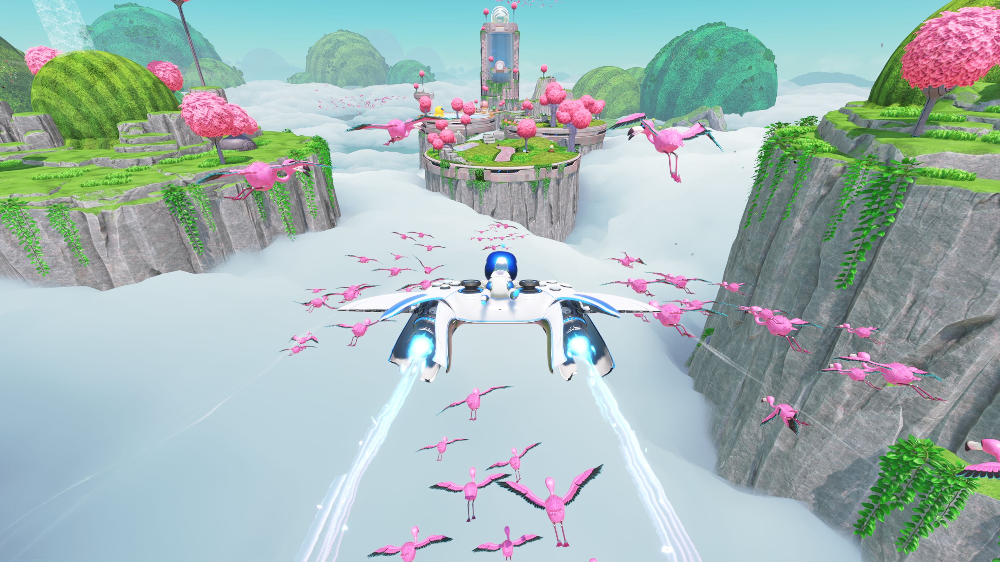

# Astro Bot — Native PC Port (AstroHybrid)

<a href="https://recomplauncher.com/game/pcportastrobot"><picture><source media="(prefers-color-scheme: dark)" srcset="https://recomplauncher.com/assets/press/launcher/badge-light.svg"></picture></a>

A native PC port of **Astro Bot** (PPSA21567, v01.019.000) for **Windows** and **Linux**, with **60+ FPS** support, **NVIDIA DLSS Super Resolution & (Multi) Frame Generation**, **AMD FSR Upscaling & Frame Generation**, **NVIDIA Reflex**, **Ultrawide (21:9 / 32:9)**, **Stability Mode**, **RecompLauncher** integration, and full controller support.

**No game files are in this repository or in the download**, and none will be: no game executable, assets, shaders, keys, saves, or game artwork. You need your own legally owned decrypted dump of the game; the setup converts it locally on your PC.

## How It Works

This is **not an emulator** — it is a native PC port:

- **AnyPS5:** Relinks the game's original x86-64 code directly into a native PC executable (`AstroBot.exe`), with PS5 system libraries (kernel, libc, audio, controller input, save data, etc.) implemented natively.
- **Vulkan Graphics Translation:** Translates the game's native PS5 graphics command buffers and shaders directly to **Vulkan**, with **NVIDIA DLSS**, **AMD FSR**, **Frame Generation**, and **NVIDIA Reflex** integrated on top.

## Download and Play

1. Download the **AstroBotPC-AstroHybrid** zip from the [latest release](https://github.com/imnotsharingmyname/pcportastrobot/releases/latest) and extract it anywhere with ~1 GB free (your game dump stays where it is).
2. Run **AstroHybrid.exe**. Select your Astro Bot dump folder (`eboot.bin`, `sce_module`, `sce_sys`) or ZArchive (`app0.zar`) and click **Install** — setup builds the Windows version locally in about two minutes without modifying your dump.
3. On first launch, the app automatically detects your CPU, GPU, RAM, and display and applies the best settings for your PC. You can customize anything on the **Graphics**, **Controller**, and **Advanced** pages.
4. Click **Play**.

Other Astro Bot versions are accepted (only v01.019.000 has been fully tested).  
Command line: `AstroHybrid.exe --setup "<dump folder>"` runs setup headless; `--remove-game` removes what setup built.

## What You Need for 60 FPS

### 60+ FPS with Frame Generation (Recommended)
- **OS:** Windows 10 / 11 (64-bit) or Linux
- **CPU:** 6-core / 12-thread modern processor (e.g., Ryzen 5 5600 / Core i5-12400 or better)
- **GPU:** NVIDIA RTX 40/50-series (DLSS Frame Generation) or Vulkan 1.3 GPU (AMD FSR Frame Generation), 8 GB+ VRAM
- **RAM:** 16–32 GB

### 60 FPS Native (without Frame Generation)
- **OS:** Windows 10 / 11 (64-bit) or Linux
- **CPU:** 8-core / 16-thread high single-thread processor (e.g., Ryzen 7 7700X / 7800X3D or Core i7-13700K+)
- **GPU:** Vulkan 1.3 GPU, RTX 4060 Ti / 5060 or equivalent AMD GPU (with DLSS / FSR Quality or Balanced for 1440p)
- **RAM:** 32 GB recommended

### Minimum (30 FPS)
- **OS:** Windows 10 / 11 (64-bit) or Linux
- **CPU:** 6-core / 12-thread modern processor
- **GPU:** Vulkan 1.3 capable GPU (8 GB VRAM recommended)
- **RAM:** 16 GB

**Controllers:** DualSense (HD haptics, controller speaker, light bar, adaptive triggers, motion sensors), DualShock 4, Xbox, Switch Pro and compatible pads, and generic pads (whichever pad you press becomes Player 1).

## Screenshots

### Gameplay

### Launcher
| Home | Graphics |
|---|---|
|  |  |
| **Controller** | **Advanced** |
|  |  |

## Features & Progress

- **Upscaling & Frame Generation (NVIDIA & AMD):**
  - **NVIDIA DLSS Super Resolution** (Quality / Balanced / Performance / DLAA) on any RTX GPU, **DLSS Frame Generation (2x)** on RTX 40-series+, **Multi Frame Generation (3x / 4x)** on RTX 50-series, **Adaptive Frame Generation**, and **NVIDIA Reflex**.
  - **AMD FSR** upscaling (FSR 4 / 3.1 / 2) and **FSR Frame Generation** for AMD, Intel, and non-RTX GPUs.
- **60+ FPS & Real-Time Game Speed:** Full real-time game speed at any frame rate (no slow motion below 60 FPS), with stable cloth and physics simulation.
- **Pre-Launch Shader Prep & Stability:** Smooth shader preparation before gameplay, VSync default, and stability guards.
- **Windows & Native Linux Support:** Full Windows launcher (`AstroHybrid.exe`) with built-in auto-updater and **RecompLauncher** integration, plus native Linux support.
- **Ultrawide Display Support:** Native 21:9 and 32:9 ultrawide render-space support.
- **ZArchive (`app0.zar`) & Mods Support:** Supports both standard decrypted dumps and ZArchive (`app0.zar`) dumps, plus a dedicated `mods` folder.
- **Built-in Performance Overlay:** Shows both on-screen FPS and native game FPS (`F2`), plus `F11` / `Alt+Enter` fullscreen toggle.
- **Laptop / Hybrid GPU Support:** Automatically detects discrete GPUs on Optimus / dual-GPU laptops and lets you pick your Vulkan adapter in Graphics settings.
- **Full Controller Support:**
  - **DualSense:** HD haptics, controller speaker, adaptive triggers (adjustable strength), light bar, and gyro/accelerometer motion.
  - **DualShock 4, Xbox, Switch Pro & Generic Pads:** Full support with customizable vibration strength, Switch gyro calibration, and right-stick tilt/motion controls.

## Notes on Upscaling & Frame Generation

- **NVIDIA DLSS Super Resolution & Reflex:** Any NVIDIA RTX GPU.
- **NVIDIA DLSS Frame Generation:** RTX 40-series or newer (3x / 4x Multi Frame Generation requires RTX 50-series).
- **AMD FSR Upscaling & Frame Generation:** Supported across Vulkan 1.3 GPUs (AMD, NVIDIA, Intel).
- Frame Generation is active while the game window is focused. Do not combine it with NVIDIA Smooth Motion.

## Status

Work in progress, personal research project. Not affiliated with or endorsed by Sony Interactive Entertainment, Team ASOBI, NVIDIA, or AMD. Astro Bot is a trademark of its owners; NVIDIA, DLSS, and Reflex are trademarks of NVIDIA; AMD and FidelityFX / FSR are trademarks of AMD.
